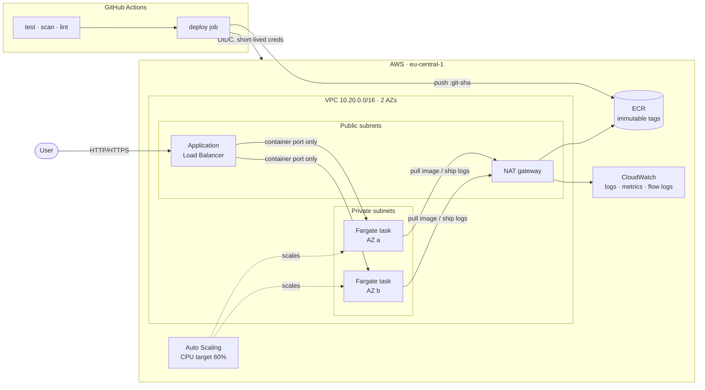
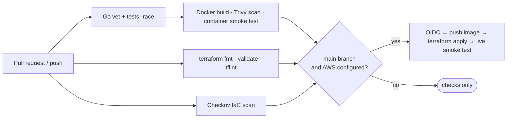

# ECS Fargate platform with Terraform & GitHub Actions

[](https://github.com/binayrawat/aws-ecs-fargate-terraform/actions/workflows/ci.yml)


A production-style reference for running a containerised service on **AWS ECS Fargate**:
modular Terraform, a private network, zero-downtime deployments with automatic rollback,
and a GitHub Actions pipeline that tests, scans and deploys **without storing any AWS keys**.

It is a personal lab, built to show how I structure this kind of platform. It contains no
code or configuration from any employer.

---

## Architecture



**Request path:** internet → ALB (public subnets) → Fargate tasks (private subnets). The tasks'
security group only accepts traffic from the ALB's security group, on the container port.

**Delivery path:** every push to `main` runs tests and scans. If they all pass, CI assumes an
AWS role through OIDC, pushes an image tagged with the commit SHA, runs `terraform apply`,
and smoke-tests the live URL until it serves the new version.

---

## What this demonstrates

| Area | Implementation |
|---|---|
| **Infrastructure as code** | Reusable `network` and `ecs-service` modules, composed per environment. Remote state in S3 with native locking (`use_lockfile`), no DynamoDB table. Provider versions pinned in lock files. |
| **Networking** | VPC across 2 AZs, public and private subnets, single NAT gateway, VPC flow logs, default security group locked down. |
| **Zero-downtime deploys** | Rolling deployment (100% min healthy / 200% max), ECS **deployment circuit breaker with automatic rollback**, and `wait_for_steady_state`, so a broken release fails the pipeline instead of reporting success. |
| **Container hardening** | Multi-stage build to a **distroless, non-root** image (~10 MB), read-only root filesystem, built-in `-healthcheck` mode since there's no shell or curl. |
| **Graceful shutdown** | The app drains in-flight requests on `SIGTERM` within ECS's stop timeout, and the target group deregistration delay is tuned to 30s. |
| **Keyless CI/CD** | GitHub OIDC → IAM role trusted **only** for this repo's `dev` environment. No long-lived AWS keys exist anywhere. |
| **Least privilege** | Deploy role scoped to one ECR repo, one state bucket, one region, and IAM roles named `<project>-*`, with an explicit deny on editing itself. Task role has no permissions. |
| **Supply-chain hygiene** | Every GitHub Action pinned to a commit SHA, Trivy image scan (fails on fixable HIGH/CRITICAL), Checkov IaC scan, tflint, and Dependabot for Go, Docker, Actions and Terraform. |
| **Observability** | Structured JSON logs, Container Insights, ALB health checks, CPU-based autoscaling (1–3 tasks). |

---

## Repository layout

```
.
├── app/                          # Go HTTP service + distroless Dockerfile
├── terraform/
│   ├── bootstrap/                # one-time: state bucket, ECR repo, GitHub OIDC role
│   ├── modules/
│   │   ├── network/              # VPC, subnets, NAT, flow logs
│   │   └── ecs-service/          # ALB, ECS cluster/service, IAM, autoscaling
│   └── environments/
│       └── dev/                  # composes the modules for the dev environment
├── .github/workflows/ci.yml      # test → scan → lint → deploy
├── .checkov.yaml                 # IaC scan config, every skip documented
└── Makefile                      # local shortcuts
```

---

## Pipeline



Pull requests run every check. The deploy job only runs on `main`, and only once the AWS
repository variables exist, so the repo stays green for anyone who forks it.

---

## Run it locally

Requires Go 1.23+ (and Docker for the image).

```bash
make test          # go vet + race-enabled tests
make run           # http://localhost:8080
curl localhost:8080/version

make docker-build  # build the distroless image
make docker-run
```

| Endpoint | Purpose |
|---|---|
| `GET /` | Hello response |
| `GET /healthz` | Health check used by the ALB and ECS |
| `GET /version` | Running build (commit SHA) and environment |

---

## Deploy to your own AWS account

> ⚠️ This creates billable resources. See [Cost](#cost) and [Teardown](#teardown).

**1. Bootstrap (once, with admin credentials)**

```bash
cd terraform/bootstrap
terraform init
terraform apply -var="github_repository=<you>/<your-fork>"
```

If your account already has a GitHub OIDC provider, add `-var="create_github_oidc_provider=false"`.

**2. Configure GitHub** (repo → *Settings → Secrets and variables → Actions → Variables*)

| Variable | Value |
|---|---|
| `AWS_ROLE_ARN` | `github_deploy_role_arn` output |
| `AWS_REGION` | `region` output (default `eu-central-1`) |
| `TF_STATE_BUCKET` | `state_bucket` output |

Then create an environment named **`dev`** (*Settings → Environments*). Add required reviewers
there if you want a manual approval before each deploy.

**3. Push to `main`.** The pipeline builds, deploys, and prints the live URL on the run summary.

To deploy from your machine instead:

```bash
cd terraform/environments/dev
terraform init -backend-config="bucket=<state_bucket>" -backend-config="region=eu-central-1"
terraform apply -var="image_tag=<an image tag already in ECR>"
```

---

## Cost

Rough eu-central-1 on-demand prices for the `dev` environment running 24/7:

| Resource | ~ per month |
|---|---|
| NAT gateway (+ its public IPv4) | $40 |
| Application Load Balancer (+ 2 public IPv4) | $25 |
| 1 Fargate task, 0.25 vCPU / 0.5 GB | $10 |
| CloudWatch logs, Container Insights, ECR | $2–5 |
| **Total** | **≈ $80** (≈ $2.60/day) |

For a cheaper lab, set `enable_nat_gateway = false`. Tasks then run in public subnets with a
public IP (their security group still only admits the ALB), which saves about $35/month.
Destroy the environment when you're not using it.

---

## Teardown

```bash
cd terraform/environments/dev
terraform destroy -var="image_tag=unused"
```

The bootstrap stack's state bucket has `prevent_destroy` on purpose. Remove that line before
destroying it, and empty the ECR repository first.

---

## Design decisions & trade-offs

- **ECS Fargate over EKS.** For a handful of stateless services, Fargate removes node
  management, cluster upgrades and add-on maintenance entirely. EKS earns its overhead when you
  need the Kubernetes ecosystem, many teams, or portability.
- **Single NAT gateway.** One NAT is a cost-for-resilience trade: if its AZ fails, tasks in the
  other AZ lose outbound access. Production would run one NAT per AZ, or VPC interface
  endpoints for ECR, S3 and CloudWatch to avoid NAT for AWS traffic altogether.
- **Image tags are commit SHAs, and ECR tags are immutable.** Every running task maps to exactly
  one commit, and nothing can silently overwrite a tag that's in use.
- **Terraform owns the deploy.** CI changes the image tag and runs `terraform apply`, so the
  task definition in state always matches what's running, with no drift from out-of-band
  `aws ecs update-service` calls. Autoscaling owns `desired_count` after the first deploy.
- **Checkov skips are explicit.** Each suppressed check in [`.checkov.yaml`](.checkov.yaml) states
  the reason and what production would do instead (WAF, access logs, KMS keys, longer retention).

## Roadmap

- `terraform plan` posted as a comment on pull requests (read-only OIDC role)
- `staging` and `prod` environments with a promotion step and manual approval
- VPC endpoints for ECR, S3 and CloudWatch Logs
- Secrets from AWS Secrets Manager injected into the task definition
- CloudWatch alarms on 5xx rate and target response time, routed to SNS

---

**Author:** [Binay Rawat](https://binayrawat.github.io) · Senior DevOps / Cloud Platform Engineer ·
[LinkedIn](https://linkedin.com/in/binay-rawat-331a6841)

Licensed under the [MIT License](LICENSE).
